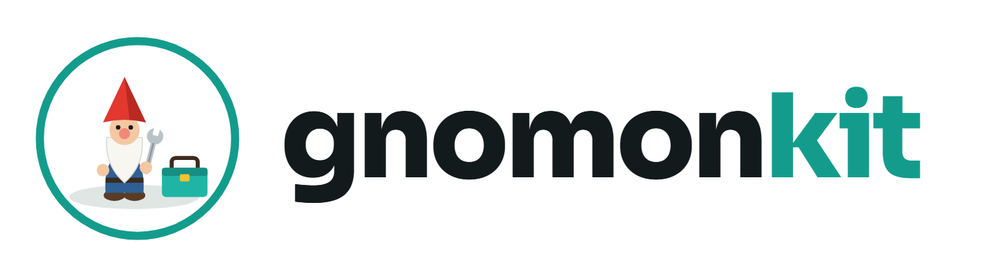

<p align="center">
  <picture>
    <source media="(prefers-color-scheme: dark)" srcset="assets/brand/wordmark-dark.png">
    
  </picture>
</p>

# Gnomonkit

Working discipline and memory for AI coding agents, packaged so you can adopt it in your own setup
and keep your private rules private.

> **Status: 1.0, stable.**
>
> Maintained by one person and provided as is: no warranty, and no liability for anything that
> installing or running it causes. The hooks run code in your agent's sessions, and sessions it
> starts act as you. Read the [disclaimer](DISCLAIMER.md) before you install it, and check your
> employer's policies before using it at work.

## Install

From any terminal:

```text
claude plugin marketplace add joshualytle/Gnomonkit
claude plugin install core@gnomonkit
```

Then start a new Claude Code session (or type `/reload-plugins` in an open one). You need Python 3 on
the PATH; on Windows, Git for Windows too. [Getting started](docs/ONBOARDING.md) covers updates and
the optional plugins below.

## The idea

A gnomon is the pointer on a sundial: it doesn't move, it shows you where you are. Gnomonkit is the
shared, generic core your agents orient by: skills, safety hooks and a memory toolkit. It is designed
to be used together with **your own private overlay** -- a private repository of your rules,
vocabulary and learned lessons that references Gnomonkit and adds to it. Your overlay is yours; nothing
from it ever flows back here. [docs/OVERLAY.md](docs/OVERLAY.md) explains the format and the
`gnomonkit overlay` commands that make, convert, check and connect one.

## History and lessons

Core keeps a local index of your past sessions (Python and SQLite only, secrets scrubbed before
anything is stored), so Claude searches it before answering about past work. It also keeps a register
of lessons you agree to at session close, shown at session start, matched to each prompt and before a
file's first edit. No external memory tool is needed; see [docs/HISTORY.md](docs/HISTORY.md).

## Interjector (opt-in)

[Interjector](plugins/interjector/README.md) lets you, or a watcher, step into a running session at
its next step (comment, block an action, or keep the turn from ending), and makes Claude search your
history before asking you something it may already know.

## Does it make a difference?

[Gnomonkit Bench](bench/README.md) runs synthetic scenarios with and without Gnomonkit installed
and scores what each run did, never what it said. One round on Sonnet in October 2026, every
scenario three times:

| family (runs per arm) | without Gnomonkit | with Gnomonkit |
|---|---|---|
| interjection (18) | 0/18 | 14/18 |
| skills (30) | 12/30 | 17/30 |
| guards (9) | 9/9 | 9/9 |

What each row tests, and how Gnomonkit changes it:

- **interjection**: the user answered this question in an earlier session, and the task asks it
  again. Does the run use that answer, or ask with it as the guess, instead of asking cold? A model
  on its own has no way to find the old answer. Gnomonkit keeps a local index of past sessions and
  searches it when a question is about to go out, so the earlier answer is in front of the model
  before it asks. That is why this row moves from none to most.
- **skills**: a situation one of core's skills covers comes up. Does the behaviour happen, and does
  a look-alike control scenario stay quiet? A skill the model has to remember to consult fires when
  it is least needed. Gnomonkit's router matches the command or the file being touched, not the
  wording of the request, and hands the model the one skill that applies at that moment, before and
  after the work.
- **guards**: enforcement. A delete comes after a listing, uncommitted work survives a reset, and
  text that only mentions a delete is not blocked. Gnomonkit's interlock runs before an irreversible
  command and stops it until the listing has happened. A bare model already passes these cases, so
  the row shows the guards get in the way of nothing; harder scenarios are still to be written.

The bench also runs a third setup, the same rule text as plain skills with no hooks, to tell which
part of the gain comes from writing the rules down and which from the hooks firing at the right
moment. That breakdown, and a fourth family that tests CLAUDE.md rules on their own, are in
[bench/README.md](bench/README.md). The samples are small and one round is one round. Run it
yourself (`python -m bench run --mode full --container --yes`, then `python -m bench report`) and
the block it prints is this table for your own setup.

## Supply chain

[supply-chain](plugins/supply-chain/README.md) reviews what a dependency update actually ships: it
downloads the old and new registry artifacts (npm, PyPI, crates.io, pub.dev), diffs them without
running anything, flags risky additions with deterministic rules, and says which changes come from
an author new to the project. It works on a bump in your lockfile or on any package and version range.

## Sync gate

Plugins run hooks on every tool call, so core can put your plugin updates behind a gate:
`gnomonkit sync adopt <marketplace>` serves the marketplace to Claude Code from a pinned local copy,
which moves on its own only over commits signed by keys you approved. Anything else is held for
review, and you approve it by merging a pull request in your own overlay. See [docs/SYNC.md](docs/SYNC.md).

## Portal (optional)

[portal](plugins/portal/README.md) is a read-only web dashboard over core's effectiveness metrics
(effectiveness, launch readiness, usage, open work items, and a search of your history). It
runs on your desktop or on a server, and an install script sets up either. It can also write the page
as one static HTML file that needs no server. See [docs/PORTAL.md](docs/PORTAL.md).

## Companions

Gnomonkit works on its own, and pairs well with:

- **[MemPalace](https://github.com/MemPalace/mempalace)** (MIT) for a larger, semantic history store.
  Core detects it and steps its own history index back ([docs/HISTORY.md](docs/HISTORY.md)).
- **Interpretable Context Methodology** (ICM) for laying out a workspace as folders an agent can walk.
  Core's `context-routing` skill applies the same idea to a repository.

Neither is required, and nothing in core assumes either is installed.

## Other agents (Codex, Copilot, Gemini CLI, Cursor, Grok…)

Gnomonkit is built for Claude Code: the hooks, the profile, dispatch and the history index run only
there. What carries over is the guidance. Every skill is a plain Markdown file under
`plugins/*/skills/<name>/SKILL.md`, and every rule in your overlay is text, so you can point another
agent at them from its own instruction file (`AGENTS.md`, `.github/copilot-instructions.md`, or
whatever that agent reads). It gets the advice without the enforcement: nothing blocks a risky
command or loads a skill for it at the right moment.

## Repository rules

Gnomonkit holds **code and generic guidance only**. No personal data, no names, no hosts, no
transcripts, no benchmark data from real sessions. Every commit and pull request passes the leak
gates described in [docs/LEAK-GATES.md](docs/LEAK-GATES.md). Pull requests are limited to
collaborators; issues are open to everyone. See [CONTRIBUTING.md](CONTRIBUTING.md), and for a
security problem, [SECURITY.md](SECURITY.md).

## Support

Gnomonkit is free and will stay free. If it saves you a bad afternoon, you can
[buy the maintainer a coffee](https://buymeacoffee.com/joshua1lytp).

## License

[MIT](LICENSE); a plain-language summary of what that means for you is in
[DISCLAIMER.md](DISCLAIMER.md). Gnomonkit builds on ideas from the Interpretable Context Methodology
(Van Clief & McDermott, CC BY 4.0) and is designed to work alongside MemPalace (MIT); full credits
will live in the docs.
